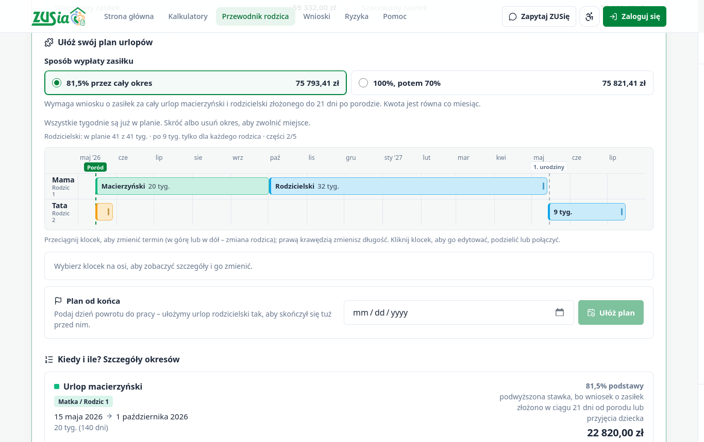
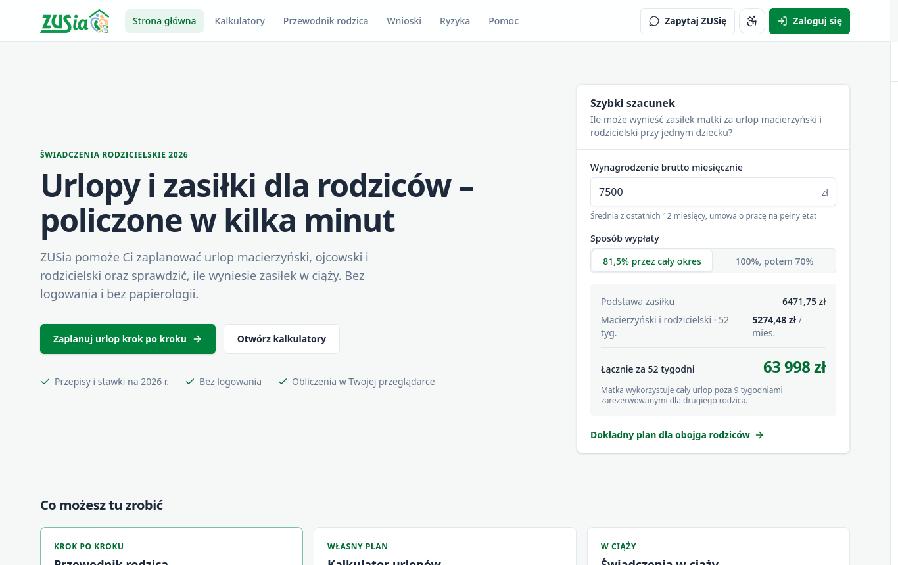

# ZUSia – Zasiłkowy Przewodnik Przyszłego Rodzica

**Zespół EmptyStack · HackNation 2026 · wyzwanie ZUS**

ZUSia pomaga przyszłym i obecnym rodzicom zrozumieć, jakie świadczenia z ubezpieczenia chorobowego im przysługują, ile wyniosą i co trzeba zrobić, żeby je dostać – zanim pojawi się decyzja ZUS. Łączy kalkulatory, interaktywny planer urlopów, przewodnik po sytuacjach szczególnych, symulację konta PUE/eZUS i wirtualną asystentkę.

> 🔗 **Demo:** _link do uzupełnienia_ · 🎬 **Film (do 3 min):** _link do uzupełnienia_ · 📊 **Prezentacja:** _link do uzupełnienia_



---

## Problem i rozwiązanie

Rodzice często nie wiedzą, że przysługuje im dane uprawnienie – albo dowiadują się o braku uprawnień dopiero z decyzji. Przepisy są rozproszone między Kodeks pracy a ustawę zasiłkową, a elastyczność (podział urlopów, praca w trakcie urlopu, stawka 81,5% czy 100% + 70%) bywa źródłem obaw zamiast szansą.

ZUSia przekłada te przepisy na konkretne liczby i daty dla indywidualnej sytuacji rodziny: pokazuje, ile wyniesie zasiłek, kto go wypłaca (pracodawca czy ZUS), jakie dokumenty złożyć i gdzie, a także ostrzega przed sytuacjami, w których można stracić prawo do świadczenia. W trudnych sytuacjach – stracie dziecka, wcześniactwie, chorobie lub śmierci matki – przełącza się w tryb wsparcia z kontaktami do sprawdzonych organizacji.

## Funkcje a wymagania wyzwania

| Wymaganie (treść zadania, pkt 3) | Gdzie w aplikacji |
|---|---|
| a) świadczenia w ciąży (zasiłek chorobowy, świadczenie rehabilitacyjne, zasiłek w wysokości macierzyńskiego), także brak uprawnień | `/kalkulatory` → zakładka „Świadczenia w ciąży” |
| b) zasiłek macierzyński dla obojga rodziców – liczba dzieci, wiek, „Za życiem” | `/kalkulatory`, `/przewodnik-rodzica` (planer urlopów) |
| c) łączenie pracy z urlopem rodzicielskim | kalkulator i planer – wymiar etatu przy każdej części urlopu (wydłużenie urlopu i niższy zasiłek) |
| d) symulacja dla obojga rodziców | planer urlopów: przeciąganie klocków między rodzicami, dzielenie i łączenie części, porównanie stawki 81,5% z 100% + 70% |
| e, j) adopcja i rodzina zastępcza niezawodowa | kalkulator oraz kafelki „Adopcja” i „Rodzina zastępcza” w przewodniku |
| f) indywidualna podstawa wymiaru, symulacja dla konkretnej sprawy | kalkulator podstawy wymiaru oraz import dokumentów sprawy (PDF/zdjęcia) wypełniający kalkulator |
| g) dokumenty, terminy, gdzie złożyć (pracodawca czy ZUS) | `/dokumenty-i-wnioski` – przewodnik zależny od świadczenia, formy zatrudnienia i wielkości płatnika |
| h) zagrożenia utraty lub obniżenia świadczeń | `/ryzyka-i-ochrona` oraz ostrzeżenia w wynikach kalkulatorów i wnioskach |
| i) organizacje wsparcia w sytuacjach szczególnych | `/pomoc-i-wsparcie` (kontakty zweryfikowane u źródła) i tryb wsparcia w przewodniku |
| zintegrowany kalkulator | jeden moduł `/kalkulatory` z wyborem scenariusza |

| Możliwość (treść zadania, pkt 3) | Realizacja |
|---|---|
| logowanie przez mObywatel (symulacja) | `/logowanie` – 4 osoby testowe o różnych sytuacjach ubezpieczeniowych |
| pobranie danych z ZUS o ubezpieczeniu lub jego braku | `/moje-konto` – tytuły ubezpieczenia, okresy, podstawy |
| zaświadczenie o stanie zadłużenia składek | `/moje-konto` – symulowane wystawienie zaświadczenia na dzień powstania prawa |
| podgląd zaświadczeń e-ZLA | `/moje-konto` – zwolnienia lekarskie, w tym z kodem „B” |
| połączenie z PUE/eZUS i pytania w razie wątpliwości | `/moje-konto` oraz asystentka ZUSia |
| wnioski o urlopy i świadczenia z wysyłką do pracodawcy/ZUS | `/moje-konto/wnioski` – wniosek o urlop macierzyński, rodzicielski, ojcowski, ZAM; adresat dobierany automatycznie, podpis mObywatel (symulacja), UPO |
| wniosek o odpis aktu urodzenia | `/moje-konto/wnioski` – odpis skrócony lub zupełny do urzędu stanu cywilnego, UPP |
| przekierowania do ZUS, MRPiPS, PIP | linki na stronach przewodnika, dokumentów i wsparcia |
| panel administracyjny do zmiany parametrów | `/admin` – patrz niżej |

### Panel administracyjny

Pracownik ZUS zmienia parametry silnika obliczeń bez udziału programistów – stawki zasiłków, kwoty, wymiary urlopów, progi wcześniactwa, terminy. Zmiany są walidowane na serwerze, zapisywane wraz z historią (z możliwością cofnięcia i resetu do wartości ustawowych na 2026 r.) i od razu działają w całej aplikacji: w kalkulatorach, planerze, wnioskach i odpowiedziach asystentki. Dostęp chroni token administratora.

Gdy aplikacja nie zdoła pobrać aktualnych parametrów, wyświetla użytkownikowi informację, że liczy na wartościach domyślnych.

### Dostępność i responsywność

Interfejs działa na komputerach i telefonach (RWD). Menu dostępności pozwala włączyć tryb ciemny, wysoki kontrast i powiększenie tekstu; planer obsługuje klawiaturę i czytniki ekranu.



## Wykorzystanie AI

**W działaniu aplikacji** AI wspiera dwie funkcje – obie wyraźnie oznaczone w interfejsie:

- **Asystentka ZUSia** (czat) – model OpenAI (domyślnie `gpt-5.4-mini`) z wyszukiwaniem w bazie wiedzy (RAG): 471 artykułów ustawy zasiłkowej, Kodeksu pracy i rozporządzeń pobranych z API Sejmu RP oraz opisy formularzy ZUS. Odpowiedzi wskazują podstawę prawną, a aktualne parametry z panelu administracyjnego mają pierwszeństwo przed bazą wiedzy. Użytkownik może dołączyć zdjęcie lub PDF do interpretacji.
- **Odczyt dokumentów sprawy** – model wyodrębnia z wgranych dokumentów dane potrzebne do kalkulatora (tytuł ubezpieczenia, okresy, wynagrodzenia); wszystkie pola można poprawić.

**Wszystkie kwoty, okresy i terminy liczy deterministyczny silnik `@zus/engine`, a nie AI.** Model OpenAI jest użyty na etapie prototypu; architektura pozwala zastąpić go modelem uruchomionym lokalnie na serwerach rządowych.

**W procesie tworzenia** AI było wykorzystywane do researchu oraz do pisania i przeglądu części kodu. Logo zostało wygenerowane przez Google Gemini. Otrzymane od ZUS dane poufne nie zostały przekazane modelom AI.

## Architektura

```mermaid
flowchart LR
  U[Przeglądarka] --> F[frontend<br/>React + Vite]
  F -- REST /api --> B[backend<br/>NestJS]
  F -- REST /api/zusia --> Z[ZUSia<br/>FastAPI]
  F -. import .-> E[(@zus/engine<br/>silnik obliczeń)]
  B -. import .-> E
  Z -- parametry silnika --> B
  Z --> G[OpenAI]
  Z --> M[(MinIO / S3<br/>załączniki, sprawy)]
```

- **`@zus/engine`** – czyste funkcje TypeScript z regułami 2026 r. (podstawa wymiaru, świadczenia w ciąży, planowanie urlopów i zasiłku macierzyńskiego). Ten sam kod liczy w przeglądarce (natychmiastowe wyniki) i na serwerze (REST API, wnioski), więc wyniki są spójne. Wszystkie liczby z przepisów przechodzą przez obiekt parametrów zmieniany w panelu administracyjnym.
- **backend (NestJS)** – REST API silnika i parametrów (walidacja, historia zmian, token administratora), symulacja mObywatel i PUE/eZUS, obsługa wniosków.
- **ZUSia (FastAPI)** – czat z bazą wiedzy, import spraw z dokumentów, przechowywanie plików w MinIO z regułą automatycznego usuwania dokumentów spraw.

## Uruchomienie lokalne

**Wymagania:** Node.js 22+, pnpm 10, Python 3.10+, Docker (dla MinIO), klucz API OpenAI.

```bash
# 1. Zależności
pnpm install
pnpm setup:zusia            # środowisko Pythona dla ZUSi (.venv)

# 2. Konfiguracja
cp .env.example .env                    # uzupełnij OPEN_AI_KEY (OpenAI)
cp backend/.env.example backend/.env    # ustaw ADMIN_TOKEN, np. openssl rand -hex 24

# 3. Magazyn plików (MinIO) – opcjonalnie; bez S3_ENDPOINT_URL ZUSia działa bez przechowywania plików
docker compose up -d

# 4. Aplikacja
pnpm dev          # silnik (watch) + backend :3000 + frontend :5173
pnpm dev:zusia    # asystentka ZUSia :8001 (w osobnym terminalu)
```

Aplikacja: **http://localhost:5173** · panel administracyjny: **/admin** (token z `backend/.env`) · konsola MinIO: http://localhost:9001.

**Osoby testowe** do logowania mObywatelem (symulacja):

| Osoba | Sytuacja |
|---|---|
| Anna | umowa o pracę, w ciąży, zwolnienie z kodem „B”, duży pracodawca |
| Magdalena | własna działalność, dobrowolne ubezpieczenie chorobowe, zaległość w składkach |
| Katarzyna | umowa zlecenia bez dobrowolnego ubezpieczenia chorobowego |
| Tomasz | ojciec po porodzie, umowa o pracę – urlop ojcowski i rodzicielski |

**Testy:** `pnpm --filter backend test` (reguły silnika, wnioski PUE, panel administracyjny).

## Struktura repozytorium

```
frontend/                    aplikacja React (strony, planer urlopów, kalkulatory, panel administracyjny)
backend/                     NestJS – REST API silnika i parametrów, symulacja PUE/mObywatel, wnioski
packages/engine/             @zus/engine – silnik obliczeń wspólny dla frontendu i backendu
python/                      ZUSia – FastAPI: czat (OpenAI + RAG), import spraw, magazyn plików
python/knowledge/            baza wiedzy: artykuły ustaw i opisy formularzy
docker-compose.yml           MinIO (S3) i automatyczne utworzenie bucketów
Materiały dodatkowe/         treść zadania i KNOWLEDGE_BASE.txt – źródła bazy wiedzy
```

## Dane i prywatność

- Przykładowe sprawy udostępnione przez ZUS **nie są częścią repozytorium**. Można je wgrać w aplikacji na potrzeby sesji testowej.
- Logowanie, konto PUE, podpis mObywatel i wysyłka wniosków są **symulowane** – żadne dane nie trafiają do prawdziwego pracodawcy, ZUS ani urzędu.
- Dokumenty spraw zapisane w MinIO są automatycznie usuwane po `CASE_RETENTION_DAYS` dniach (domyślnie 30).

## Ograniczenia i kierunki rozwoju

- **Integracje** – mObywatel, PUE/eZUS i rejestr stanu cywilnego są symulowane na danych testowych; docelowo do zastąpienia prawdziwymi usługami.
- **Panel administracyjny** – obecnie zmienia parametry silnika; kolejny krok to zarządzanie treściami (formularze, poradniki, organizacje wsparcia) oraz parametry z datą obowiązywania, by zmiana przepisów nie wpływała na wyliczenia dla wcześniej urodzonych dzieci.
- **Asystentka** – docelowo model uruchomiony lokalnie, dostęp do danych zalogowanego użytkownika (za jego zgodą) i podpowiedzi w trakcie wypełniania formularzy.
- **Terminy** – licznik czasu pozostałego na złożenie wniosków (np. 21 dni na stawkę 81,5%) oparty na danych z konta.
